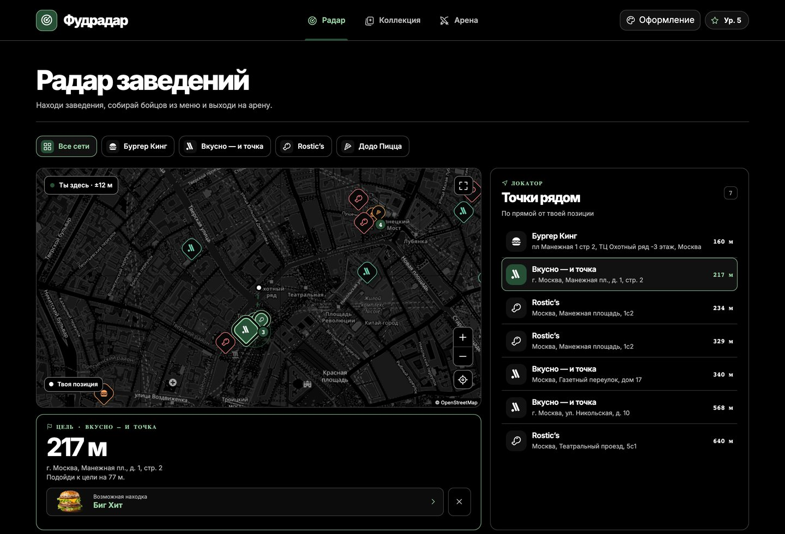

# [▶ Играть в Фудрадар](https://nelkio.github.io/RU-Fast-Food-Locator-Game/)

**Фудрадар** — городская игра по фастфуду. Дойди до настоящего Бургер Кинга, «Вкусно — и точка», Rostic’s или Додо Пиццы, открой рулетку и забери бойца прямо из меню. Потом выведи его на арену против диких бойцов или друга. Играется в браузере на телефоне и компьютере, без установки и бесплатно.



<p align="center">
  
  &nbsp;
  
  &nbsp;
  
</p>

## Как играть

1. Выбери на радаре ближайшее заведение и сделай его целью.
2. Дойди до него. Когда GPS покажет, что ты на месте, нажми «Открыть рулетку». Выпадет блюдо этой сети, и оно станет твоим бойцом.
3. Рядом появится дикий боец. Победи его, чтобы забрать в коллекцию.
4. Собери колоду из трёх бойцов. Каждый ход выбирай: обычный удар, защита, фирменный приём или суперприём. Энергия копится от удара и защиты.

Одна точка даёт рулетку раз в шесть часов, а две разные точки за день закрывают «Маршрут дня».

## Что внутри

- **4 448 заведений** четырёх сетей по всей России на живой карте. Можно фильтровать по сети, а точки в одном торговом центре собраны в общую метку.
- **47 бойцов из настоящего меню**: Воппер жжёт грилем, Четыре сыра прячется за сырным щитом, Кола 0,8 л засыпает льдом, Шеф Баскет лечит всю команду.
- **Редкость решает.** У обычного бойца один приём. Редкий получает талант: броню, шипы, регенерацию или ярость на последнем дыхании. Эпический и легендарный бьют ещё и суперприёмом, а легендарный талант делает сразу две вещи.
- **Камень, ножницы, бумага.** Внутри редкости нет бойца, который побеждает всех: у каждого есть удобные и неудобные соперники. Баланс проверен полным перебором боёв.
- **Дикие бойцы** приходят после каждого визита и подстраиваются под силу твоей колоды, поэтому шанс есть даже у новичка.
- **Дуэль с другом** по коду или ссылке. Ходы идут напрямую между браузерами, а если связь рвётся, игра переключается на резервный канал. Координаты остаются на устройстве.
- **Анимация у каждого приёма**, от горящих кружков пепперони до золотой короны «Коронации».
- **Шесть тем оформления**: «Чёрный», «Белый», «Острый соус», «После печи», «Зелёное комбо» и «На гриле». У каждой свои цвета карты и фото меню.

## Разработка

```sh
npm start              # игра на http://127.0.0.1:4173
npm test               # модульные тесты на Node.js 24 и Python 3
npm ci && npm run test:browser   # браузерные сценарии в Chrome
```

Статический сайт без сборки: ES-модули, Leaflet, OpenStreetMap, WebRTC. Устройство кода, проверки и публикация описаны в [docs/DEVELOPMENT.md](docs/DEVELOPMENT.md). Правила боя и сетевой протокол лежат в [docs/P2P.md](docs/P2P.md), источники каталога в [docs/DATA.md](docs/DATA.md), а эксперименты с балансом, с инструментами и сырыми результатами, в [docs/balance](docs/balance/README.md).

## TODO

- [x] Включить GitHub Pages для `main`. [Публичная игра](https://nelkio.github.io/RU-Fast-Food-Locator-Game/) · [Первый успешный выпуск](https://github.com/NELKIO/RU-Fast-Food-Locator-Game/actions/runs/44320515090). На опубликованном сайте в Chrome проверены карта, фото награды, сохранение после перезагрузки и вход по ссылке в комнату дуэли.
- [x] Сыграть дуэль на двух физических телефонах через разные мобильные сети: проверено игроком 19 ноября 2026 года.
- [ ] Провести полевой визит с телефона. Зафиксировать точность GPS, качество сигнала прибытия и восстановление дуэли после переключения сети посреди матча.
- [ ] Проверить результат первого планового обновления каталога в GitHub Actions. Экран совместного местоположения других игроков оставлен за рамками этой версии.
- [x] Обрыв между последним ходом и его подтверждением больше не превращает матч в отмену: исход уже определён, и через 25 секунд ожидания он сохраняется на устройстве ([ревью выпуска](https://github.com/NELKIO/RU-Fast-Food-Locator-Game/pull/1)).
- [x] Перебалансировать 47 бойцов: внутри редкости нет меты, у каждого есть контры, редкость сильнее. Точный перебор всех пар при идеальной игре и подбор чисел отжигом описаны в [docs/balance](docs/balance/README.md).
- [ ] Проверить новый баланс на живых игроках. Симуляция пока не решает командные бои 3 на 3 и уровни, а часть пар внутри редкости решает право первого хода.
- [x] Заменить фото Шефбургера и Шефролла Rostic’s на снимки без промо-плашки «%».
- [ ] Проверить плавность анимаций боя на слабом Android-телефоне. Если кадры проседают, уменьшить предел частиц в `public/js/battle-fx.js`.
- [ ] Если нагрузка вырастет, перейти с tile.openstreetmap.org на собственный или платный тайл-сервер: публичные тайлы OSM допускают только умеренный трафик.

---

<sub>Фанатский проект. Не связан с Бургер Кингом, «Вкусно — и точка», Rostic’s и Додо Пиццей. Названия и фото блюд принадлежат их владельцам. Карта © участники [OpenStreetMap](https://www.openstreetmap.org/copyright).</sub>
