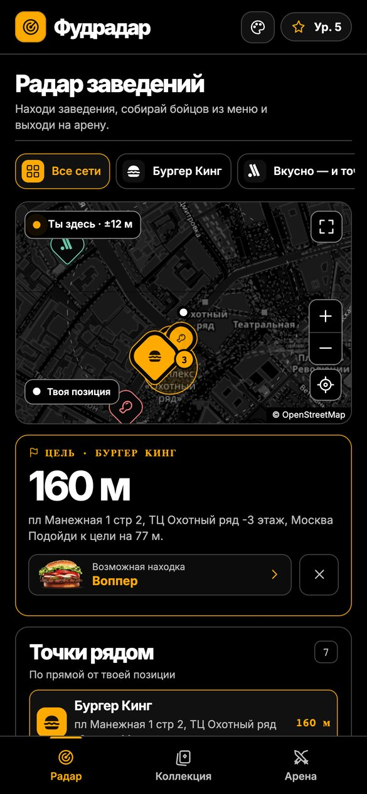
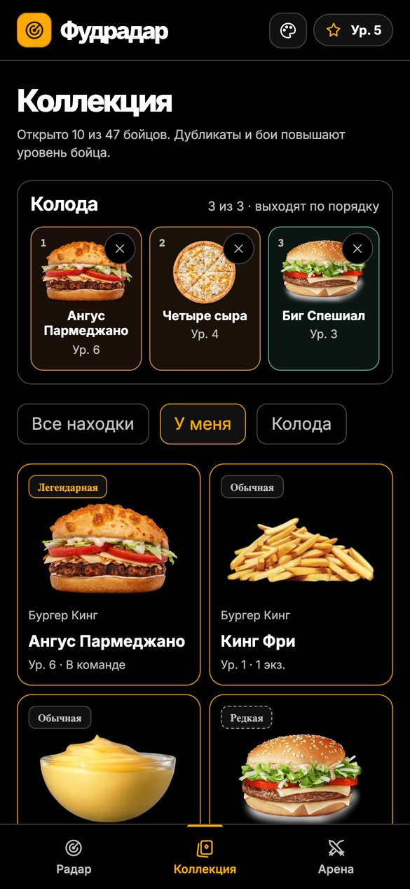
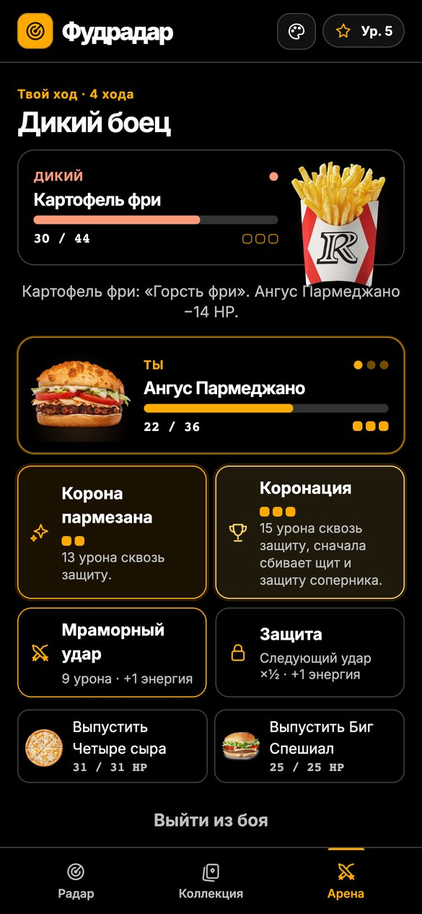

# [▶ Играть в Фудрадар](https://nelkio.github.io/RU-Fast-Food-Locator-Game/)

**Фудрадар** — городская игра по фастфуду. Дойди до настоящего Бургер Кинга, «Вкусно — и точка», Rostic’s или Додо Пиццы, открой рулетку и забери бойца прямо из меню. Потом выведи его на арену против диких бойцов или друга. Играется в браузере на телефоне и компьютере, без установки и бесплатно.


<p align="center">
  
  &nbsp;
  
  &nbsp;
  
</p>

## Как играть

1. Выбери на радаре ближайшее заведение и сделай его целью.
2. Дойди до него. Когда GPS покажет, что ты на месте, нажми «Открыть рулетку». Выпадет блюдо этой сети, и оно станет твоим бойцом.
3. Рядом появится дикий боец. Победи его, чтобы забрать в коллекцию.
4. Собери колоду из трёх бойцов. Первым ходит более быстрый боец. Каждый ход выбирай: обычный удар, защита, фирменный приём или суперприём. Энергия копится от удара и защиты.

Одна точка даёт рулетку раз в шесть часов, а две разные точки за день закрывают «Маршрут дня».

## Что внутри

- **4 448 заведений** четырёх сетей по всей России на живой карте. Можно фильтровать по сети, а точки в одном торговом центре собраны в общую метку.
- **65 бойцов из настоящего меню**: Воппер жжёт грилем, Биг Кинг усыпляет сытным обедом, комбо «6 соусов» бьёт серией из разных соусов, а мемная Влажная салфетка стирает с соперника щиты и усиления.
- **Редкость решает.** У обычного бойца один приём. Редкий получает талант: броню, шипы, регенерацию, ярость на последнем дыхании или грозный вид. Эпический и легендарный бьют ещё и суперприёмом, а легендарный талант делает сразу две вещи. В каждой сети две легенды.
- **Эффекты, как в покемонах.** Заморозка, сон (удар будит), изжога, которая растёт каждый ход, вытягивание здоровья, серия ударов, очистка. Стихий нет: всё действует на всех, поэтому любую тройку можно собрать без страха перед одним противником.
- **Есть кого искать.** Внутри редкости бойцы не равны: одни сильнее, другие слабее, а лучшие обычные и редкие могут побить старшую редкость. Легендарные сильнее почти всех, но не непобедимы: Влажная салфетка не горит и бьёт Пепперони, изжога XXL соуса перебивает лечение Шефбургера. При этом меты нет, даже у сильнейшего есть контры. Баланс проверен полным перебором боёв.
- **Скорость, как в покемонах.** Первым ходит более быстрый боец, а после нокаута быстрый может сразу ударить снова. Картошка фри и Наггетсы быстрые, Двойной Воппер и Чизкейк медленные.
- **Дикие бойцы** приходят после каждого визита и подстраиваются под силу твоей колоды, поэтому шанс есть даже у новичка. Чаще приходят те, кого у тебя ещё нет, и пять последних не повторяются.
- **Награда за вход.** Семь дней подряд: крутки, боец недели, опыт, прокачка колоды, а на седьмой день — случайный легендарный боец.
- **Один прогресс на телефоне и компьютере.** В профиле можно связать устройства ключом или ссылкой: бойцы, опыт и победы складываются и дальше обновляются сами. Без регистрации и своего сервера, данные хранятся зашифрованными.
- **Бой с тренером 3 на 3** в любое время. Десять тренеров с именами, у каждого своя сеть, Лев Б собирает сборную солянку, а Лука — Лорд тренеров с сильнейшими легендами. Три сложности: «Разминка», «Всерьёз» и «Без пощады». Тренер думает на несколько ходов вперёд, меняет бойцов и бережёт энергию на суперприём.
- **Дуэль с другом** по коду или ссылке. Ходы идут напрямую между браузерами, а если связь рвётся, игра переключается на резервный канал. Координаты остаются на устройстве.
- **Своя сцена у каждого суперприёма.** На «Коронацию» сверху падает корона, Бургер Бокс приезжает трамваем и выпускает три бургера, Биг Кинг накрывает соперника клошем, Острые крылышки поднимают огненный смерч, Кола 0,8 л вмораживает соперника в ледяную колонну, а «Нокаут» Ростмастера бьёт перчаткой со звёздами над головой. У обычных ударов и приёмов тоже свои анимации: кольцо лука летит обручем, стрипсы хлещут кнутом.
- **Шесть тем оформления**: «Чёрный», «Белый», «Острый соус», «После печи», «Зелёное комбо» и «На гриле». У каждой свои цвета карты и фото меню.

## Разработка

```sh
npm start              # игра на http://127.0.0.1:4173
npm test               # модульные тесты на Node.js 24 и Python 3
npm ci && npm run test:browser   # браузерные сценарии в Chrome
```

Статический сайт без сборки: ES-модули, Leaflet, OpenStreetMap, WebRTC. Устройство кода, проверки и публикация описаны в [docs/DEVELOPMENT.md](docs/DEVELOPMENT.md). Правила боя и сетевой протокол лежат в [docs/P2P.md](docs/P2P.md), синхронизация устройств в [docs/SYNC.md](docs/SYNC.md), источники каталога в [docs/DATA.md](docs/DATA.md), а эксперименты с балансом, с инструментами и сырыми результатами, в [docs/balance](docs/balance/README.md).

## TODO

- [x] Включить GitHub Pages для `main`. [Публичная игра](https://nelkio.github.io/RU-Fast-Food-Locator-Game/) · [Первый успешный выпуск](https://github.com/NELKIO/RU-Fast-Food-Locator-Game/actions/runs/44320515090). На опубликованном сайте в Chrome проверены карта, фото награды, сохранение после перезагрузки и вход по ссылке в комнату дуэли.
- [x] Сыграть дуэль на двух физических телефонах через разные мобильные сети: проверено игроком 19 ноября 2026 года.
- [ ] Провести полевой визит с телефона. Зафиксировать точность GPS, качество сигнала прибытия и восстановление дуэли после переключения сети посреди матча.
- [ ] Проверить результат первого планового обновления каталога в GitHub Actions. Экран совместного местоположения других игроков оставлен за рамками этой версии.
- [x] Обрыв между последним ходом и его подтверждением больше не превращает матч в отмену: исход уже определён, и через 25 секунд ожидания он сохраняется на устройстве ([ревью выпуска](https://github.com/NELKIO/RU-Fast-Food-Locator-Game/pull/1)).
- [x] Перебалансировать 47 бойцов: внутри редкости нет меты, у каждого есть контры, редкость сильнее. Точный перебор всех пар при идеальной игре и подбор чисел отжигом описаны в [docs/balance](docs/balance/README.md).
- [x] Добавить скорость, которая решает, кто ходит первым, и ослабить баланс до лестницы внутри редкости, чтобы было интересно искать сильных бойцов.
- [ ] Проверить новый баланс на живых игроках. Симуляция пока не решает командные бои 3 на 3 и уровни.
- [x] Добавить 22 бойца, вторую легенду в каждой сети и новые эффекты, пересчитать баланс так, чтобы у каждой легенды был эпик-контра ([docs/balance](docs/balance/README.md)).
- [x] Шесть соусов объединены в комбо «6 соусов», Ай-Ролл стал эпическим, добавлен Маффин, Мороженое Рожок снова отнимает энергию, заморозка осталась только у слабых бойцов. Награда за вход неделю подряд, реже повторы диких бойцов.
- [x] Режим «Бой с тренером» 3 на 3 с сильным компьютерным соперником; дикие бойцы стали сложнее для редких команд и ходят тем же ботом.
- [x] Тренеры с именами, Лорд тренеров Лука и выбор сложности. Дикие бойцы идут из потока профиля, поэтому два устройства видят одного и того же бойца, а законченный бой не теряется.
- [ ] Следующий раунд: новые пассивки, предметы и парные бойцы или смена облика по идеям эксперта по покемонам, затем вернуть эпикам против редких 72–88% побед (сейчас 98%).
- [x] Заменить фото Шефбургера и Шефролла Rostic’s на снимки без промо-плашки «%».
- [x] Синхронизация прогресса между устройствами без сервера: CRDT-слияние и зашифрованное хранение на узлах Nostr ([docs/SYNC.md](docs/SYNC.md)).
- [ ] Проверить связывание устройств на двух физических телефонах в мобильных сетях, в том числе доступность узлов nos.lol и Damus.
- [ ] Проверить плавность анимаций боя на слабом Android-телефоне. Если кадры проседают, уменьшить предел частиц в `public/js/battle-fx.js`.
- [ ] Если нагрузка вырастет, перейти с tile.openstreetmap.org на собственный или платный тайл-сервер: публичные тайлы OSM допускают только умеренный трафик.

---

<sub>Фанатский проект. Не связан с Бургер Кингом, «Вкусно — и точка», Rostic’s и Додо Пиццей. Названия и фото блюд принадлежат их владельцам. Карта © участники [OpenStreetMap](https://www.openstreetmap.org/copyright).</sub>
